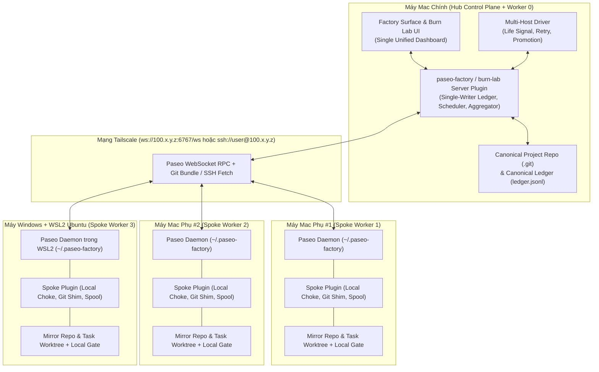
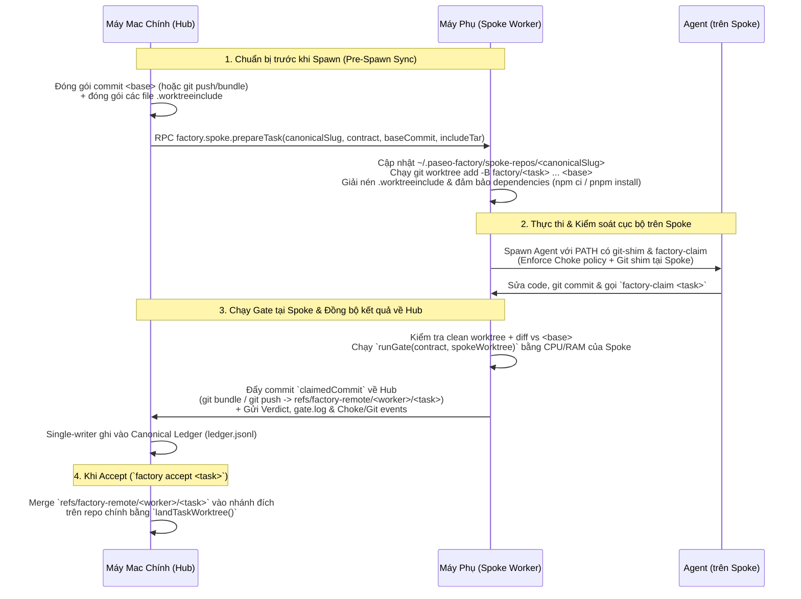

# Nghiên cứu Kiến trúc Đa máy (Multi-Machine Factory Connector) cho `paseo-factory` & `factory-burn-lab`

> **Cập nhật sau phiên `/grill-with-docs` (2026-10-17):** Từ phân tích nền tảng trong tài liệu này, kiến trúc chính thức của `factory-connector` đã được nâng cấp từ mô hình bất đối xứng `Hub–Spoke` sang **Symmetric Peer `Fleet`** (mọi `Node` đều tự chủ 100%, hỗ trợ **`Handoff`** trọn gói để laptop `mobile` gập máy an toàn, **`Burst`** chia tải song song, và **`Fleet pulse`** siêu tiết kiệm băng thông qua Tailscale). Xem quyết định chính thức tại [`docs/adr/0001-symmetric-peer-fleet-handoff-and-burst-mesh.md`](../adr/0001-symmetric-peer-fleet-handoff-and-burst-mesh.md) và ngôn ngữ miền tại [`CONTEXT.md`](../../CONTEXT.md).

- **Ngày thực hiện:** 2026-10-17
- **Phạm vi nghiên cứu:**
  - `paseo-factory` (`/Users/andrewpham/Documents/code/self-project/research-slp`)
  - `factory-burn-lab` (`/Users/andrewpham/Documents/code/self-project/factory-burn-lab`)
  - Paseo SDK & Runtime (`@getpaseo/client`, `@getpaseo/plugin`, `@getpaseo/protocol`, `@getpaseo/relay`, `@getpaseo/cli`, `@getpaseo/server` trong `/Applications/Paseo.app/Contents/Resources/app.asar`)
- **Bối cảnh bài toán:** Người dùng sở hữu **4 máy tính** kết nối trong cùng mạng **Tailscale** (**1 máy Mac chính** đang chạy `paseo-factory` + `factory-burn-lab`, **2 máy Mac phụ**, và **1 máy Windows**). Mục tiêu là thiết kế một cơ chế kết nối (`factory-connector`) để:
  1. Phân bổ tải thực thi các `Burn run` song song của `factory-burn-lab` và các `Task` / `Attempt` của `paseo-factory` sang cả 4 máy (tận dụng CPU/RAM, quota/rate-limit theo máy, và băng thông).
  2. Quan sát và điều khiển tập trung từ một nơi duy nhất (máy Mac chính) mà không phải mở từng máy kiểm tra thủ công.
  3. Giữ nguyên các bất biến cốt lõi (SLP invariants) của `paseo-factory` (`Single-writer Ledger`, `Choke policy`, `Git shim`, `Task worktree`, `Gate` cơ học, `Life signal` / `Substrate death` / `Denial-stall`) và `factory-burn-lab` (`Citation gate`, `Council`, `Free pool`).

---

## Tóm tắt Điều hành (Executive Summary)

1. **Paseo đã có sẵn nền tảng mạng đa-daemon (Multi-Daemon Transport), nhưng chưa có lớp điều phối (Orchestration) liên máy:**
   - `@getpaseo/client`, `@getpaseo/protocol` và `@getpaseo/cli` đã hỗ trợ kết nối từ xa tới bất kỳ Paseo daemon nào qua **TCP/WebSocket trực tiếp (`ws://100.x.y.z:6767/ws`)**, **SSH Tunnel tích hợp (`ssh://user@100.x.y.z?daemonPort=6767`)**, hoặc **E2EE Relay**.
   - Tuy nhiên, Paseo Desktop chỉ cho phép **chuyển đổi góc nhìn từng host một** (thông qua *host picker* trên header của plugin screen), chứ không tự động gộp trạng thái hay phân phối `Task` giữa các host.
   - Bản thân `paseo-factory` và `factory-burn-lab` hiện đang giả định **100% thực thi cục bộ trên một máy POSIX duy nhất** (local filesystem spool `renameSync`, `git worktree` dùng chung `.git`, `#!/bin/sh` wrappers, `PATH` phân tách bằng `:`).

2. **So sánh 2 hướng tiếp cận chính:**
   - **Hướng 1 — Kết nối ở tầng Agent (Agent-to-Agent / Remote Harness qua SSH hoặc MCP):**
     - *Rất phù hợp và rẻ* cho các bước **stateless hoặc semi-stateless** của `factory-burn-lab` (như `Scout pool`, `OSS lab`, hoặc `Council` chấm điểm chéo qua CLI `opencode run --standalone`).
     - *Không phù hợp (phá vỡ kiến trúc)* nếu áp dụng thô cho `paseo-factory`: nếu một `Agent` hoặc `Lead` tự SSH sang máy khác hay gọi peer-to-peer sang agent khác, toàn bộ `Choke policy` (`agent.permission_requested`), `Git shim` (`git-blocked.log`), bộ phân loại `Life signal` / `Substrate death` (`seqEnd` trên timeline của Paseo daemon), và nguyên tắc `Single-writer Ledger` (`ADR 0004`) sẽ bị vô hiệu hóa.
   - **Hướng 2 — Kết nối ở tầng Daemon / Plugin Paseo (Kiến trúc Hub-and-Spoke qua Tailscale):**
     - **Biến thể 2A (Central Hub Plugin điều khiển trực tiếp Remote Paseo Daemons qua WebSocket/SSH):** Tốt cho việc gom `Meter`, stream `Timeline`, và chạy các tác vụ `Burn run` không phụ thuộc local hooks phức tạp.
     - **Biến thể 2B (Hub-and-Spoke `paseo-factory` Plugin + Đồng bộ Git-native):** Mỗi máy chạy Paseo daemon + plugin `paseo-factory` ở chế độ **Spoke** (thực thi `Choke policy`, `Git shim`, `Pi harness home`, `Task worktree` và chạy `Gate` bằng CPU/RAM của máy Spoke), trong khi máy Mac chính đóng vai trò **Hub** (giữ `Single-writer Ledger`, điều phối `Driver`, tổng hợp UI `Factory surface` & `Burn lab`, và nhận kết quả qua Git bundle/fetch + RPC). **Đây là kiến trúc chuẩn xác nhất cho `paseo-factory`.**

3. **Giải pháp cho máy Windows (2 Mac + 1 Windows):**
   - Trong ngắn và trung hạn, **chạy Paseo daemon + worker bên trong WSL2 (Ubuntu) trên máy Windows** là con đường tối ưu tuyệt đối: biến máy Windows thành một node Linux POSIX chuẩn 100%, tương thích tức thì với `#!/bin/sh` wrapper, `symlinkSync`, `/tmp`, `process.kill(-pid)` và mọi câu lệnh `Gate` (`npm test && ...`) mà không cần sửa logic POSIX của repo.

---

## 1. Thực trạng Hạ tầng Paseo & Các Giả định Đơn máy (Single-Machine Assumptions)

### 1.1. Khả năng kết nối từ xa có sẵn của Paseo (`@getpaseo/*`)

Qua kiểm tra mã nguồn của Paseo SDK trong `node_modules/@getpaseo/*` và bundle `/Applications/Paseo.app/Contents/Resources/app.asar`, Paseo **không phải** là một ứng dụng chỉ chạy localhost:

1. **4 cơ chế truyền tải (Transport) tới Daemon từ xa:**
   - Trong `@getpaseo/protocol/dist/daemon-endpoints.js:52-182` và `@getpaseo/cli/dist/utils/client.js:48-115, 195-248`, Paseo định nghĩa rõ 4 loại endpoint:
     - **Direct TCP / WebSocket (`host:port` hoặc `tcp://host:port?password=...&ssl=true`):** Kết nối thẳng tới `ws://<host>:<port>/ws` (hoặc `wss://`).
     - **SSH Tunnel nội tại (`ssh://user@host[:port]?daemonPort=6767`):** Trong `@getpaseo/protocol/dist/ssh-transport.js:18-67` và `@getpaseo/cli/dist/ssh/ssh-tunnel.js`, Paseo tự mở một cổng loopback tạm (`127.0.0.1:0`) trên máy gọi và chạy tiến trình:
       ```bash
       ssh -T -o BatchMode=yes -o ConnectTimeout=10 -o ClearAllForwardings=yes -o ExitOnForwardFailure=yes -W 127.0.0.1:6767 <user@host>
       ```
       Đặc điểm này cực kỳ giá trị khi kết hợp với **Tailscale SSH**: Paseo daemon ở các máy phụ chỉ cần lắng nghe trên `127.0.0.1:6767` (không cần mở port TCP ra ngoài), và máy Mac chính có thể kết nối qua `ssh://user@100.x.y.z?daemonPort=6767`.
     - **E2EE Relay (`relay://...` hoặc `#offer=<base64url>`):** Mã hóa đầu cuối qua relay server (`@getpaseo/protocol/dist/connection-offer.js:8-52`, `@getpaseo/relay/dist/e2ee.js`).
     - **Local IPC (`unix://` hoặc Windows Named Pipe `pipe://` / `\\.\pipe\`):** Dùng cho kết nối nội bộ (`@getpaseo/cli/dist/utils/client.js:68-103`).

2. **Cơ chế Lắng nghe (Listen), Kiểm tra Hostname và Xác thực (Auth) của Daemon:**
   - **Listen:** `@getpaseo/server/dist/server/server/config.js:89-103` đọc `daemon.listen` trong `~/.paseo-factory/config.json` (hoặc biến môi trường `PASEO_LISTEN`), mặc định là `127.0.0.1:6767`. Có thể đổi thành IP Tailscale (`100.x.y.z:6767`) hoặc `0.0.0.0:6767`.
   - **Hostname Admission:** `@getpaseo/server/dist/server/server/hostnames.js:33-57` có hàm `isDefaultAllowedHostname(hostname)` mặc định cho phép `localhost`, `*.localhost`, và **mọi địa chỉ IP hợp lệ (`net.isIP(hostname) !== 0`)**. Do đó, nếu kết nối bằng IP Tailscale (`100.x.y.z`), daemon chấp nhận ngay lập tức mà không bị chặn Host header. Nếu dùng tên miền MagicDNS của Tailscale (`mac-mini.tailnet.ts.net`), chỉ cần bật `daemon.hostnames: true` (hoặc `PASEO_HOSTNAMES=true`).
   - **Authentication:** `@getpaseo/server/dist/server/server/session-admission-auth.js:4-25` kiểm tra `daemon.auth.password` (bcrypt hash tạo bởi `paseo daemon set-password` hoặc `PASEO_PASSWORD`). Khi client kết nối từ xa qua `@getpaseo/client/dist/daemon-client.js:52-71`, mật khẩu được truyền qua WebSocket subprotocol `paseo.bearer.<base64url(password)>`.

3. **Khả năng của `@getpaseo/client` (`DaemonClient`) và Trình biên dịch Plugin:**
   - `@getpaseo/client/dist/daemon-client.d.ts:9, 201-259` cung cấp đầy đủ API từ xa: `createAgent`, `sendAgentMessage`, `respondToPermission`, `subscribeAgentLifecycle`, `fetchAgentTimeline`, `listProviderUsage`, các RPC về Git (`checkoutStatus`, `checkoutCommit`, `checkoutPull`, `checkoutPush`, `createPaseoWorktree`), và **truyền file nhị phân qua WebSocket** (`FileTransferOpcode` trong `@getpaseo/protocol/dist/binary-frames/file-transfer.d.ts`).
   - Trong `@getpaseo/server/dist/server/server/plugins/compiler.js:8-15, 162-215`, server bundle của plugin (`plugin/index.server.ts`) được biên dịch bằng `esbuild` với `platform: "node"`, `target: "node20"`, cho phép dùng toàn bộ `node:*` built-ins, `WebSocket` toàn cục của Node 24, và đóng gói trực tiếp các thư viện như `@getpaseo/client` vào server plugin.

4. **Giới hạn của Paseo Desktop Multi-Host UI:**
   - Theo tài liệu nội bộ `@getpaseo/server/dist/server/skills/paseo-plugin/SKILL.md`:
     > *"When the same screen or sidebar item exists on several connected hosts, Paseo shows it once. The screen header has a host picker... The selected host owns the bundle, SDK calls, RPCs, and query cache."*
   - Nghĩa là Paseo Desktop chỉ cho phép **xem từng máy một** bằng cách bấm chọn host trên thanh tiêu đề, chứ **không có bảng điều khiển hợp nhất (Unified Control Plane)** hay bộ lập lịch phân tán (Distributed Scheduler).

---

### 1.2. Các điểm neo Cục bộ (Single-Machine Coupling) trong `paseo-factory` & `factory-burn-lab`

Khi đối chiếu với mã nguồn hiện tại của `paseo-factory` và `factory-burn-lab`, có **6 điểm neo cục bộ** ngăn cản việc chia tải qua mạng nếu không có lớp `factory-connector`:

| Thành phần | Vị trí mã nguồn | Giả định cục bộ hiện tại | Hệ quả khi chạy đa máy |
| :--- | :--- | :--- | :--- |
| **1. Định danh Project (`<project-slug>`)** | `src/project.ts` & `docs/adr/0010-project-scoped-slp-worktrees-and-lead-agent.md` (§1) | `<project-slug> = <basename>-<sha1(gitCommonDir).slice(0,6)>` tính từ đường dẫn tuyệt đối của `.git` trên máy hiện tại (VD: `/Users/andrewpham/.../.git`). | Nếu máy Mac 2 hoặc máy Windows đặt repo ở đường dẫn khác (hoặc khác username), mã băm SHA-1 6 ký tự sẽ khác nhau, sinh ra 2 `<project-slug>` lệch nhau. |
| **2. Giao thức Spool (`spool`)** | `plugin/server/spool.ts:271-274, 638-719`, `plugin/bin/spool-client.mjs:31-59` (`ADR 0004`) | CLI (`factory`, `factory-claim`) giao tiếp với plugin server bằng cách ghi file JSON tạm và `renameSync` nguyên tử vào `<stateDir>/spool/requests/`, sau đó poll `<stateDir>/spool/replies/<id>.json`. | Một tiến trình `Agent` hoặc `Driver` chạy trên máy phụ không thể `renameSync` xuyên qua mạng vào ổ đĩa của máy Mac chính. |
| **3. `Choke policy` & `Git shim` (`PATH`)** | `plugin/server/shell.ts:51-86`, `plugin/server/choke.ts:71, 274-335`, `plugin/bin/git-shim.mjs:63` | Khi `agent.session_open` kích hoạt trên daemon cục bộ, plugin tiêm `<stateDir>/bin` vào `PATH` của agent. Khi agent gọi `git` bị cấm, `git-shim.mjs` ghi vào `<stateDir>/git-blocked.log` để plugin đọc mỗi 250ms (`readFileSync`). | Nếu máy chính chỉ điều khiển một shell từ xa qua SSH mà không có plugin/shim ở đầu xa, hoặc nếu shim ở máy xa ghi log tại máy xa, `Ledger` ở máy chính sẽ mất dấu `git_blocked` và `permit_denied`. |
| **4. `Task worktree` & `Workspace` Git** | `plugin/bin/task-worktree.mjs:46-120`, `src/workspace.ts:27-266` | Dùng `git worktree add -B factory/<task> <stateDir>/projects/<slug>/worktrees/<task> <base>`. Khi `Claim` và `Accept`, `resolveClaimedCommit()`, `checkCleanAt()`, `changedFiles()` và `landTaskWorktree()` đọc trực tiếp object store `.git` cục bộ. | `git worktree` yêu cầu dùng chung thư mục `.git` vật lý trên cùng một ổ đĩa. Máy phụ không tự động có commit `<base>`, không có các file untracked trong `.worktreeinclude` (như `.env`), và commit do `Agent` tạo ở máy phụ không tự động xuất hiện trong `.git` của máy chính để `landTaskWorktree()` merge. |
| **5. `Gate` cơ học** | `src/gate.ts:48-116`, `plugin/server/spool.ts:471-528` | Khi xử lý `claim` trong `spool.ts`, plugin chạy trực tiếp `runGate(contract, cwd)` bằng `spawn(cmd, { shell: true, cwd })` ngay trên máy đang giữ Spool/Ledger. | Nếu `Agent` làm việc ở máy phụ nhưng `Gate` lại chạy ở máy chính (hoặc ngược lại) mà chưa đồng bộ cây thư mục/commit, `Gate` sẽ kiểm tra sai trạng thái code hoặc không tận dụng được CPU/RAM của máy phụ. |
| **6. `factory-burn-lab` Runners** | `../factory-burn-lab/src/burn-engine.ts:573-757, 921-953`, `src/free-pool.ts:312-578` | `runOpenCodeFreeModel`, `defaultSupervisorRunner`, `defaultGateRunner` và `prepareIsolatedWorktree` đều gọi `spawn("opencode", ...)` / `spawn("sh", ["-c", ...])` trên máy cục bộ và lưu worktree tại `<paseoHome>/burn-lab/runs/<runId>/worktrees/<attemptId>`. | Toàn bộ các `Free model` probes (`scout-pool`), các model đọc 1M context (`oss-lab`), và các nhánh thi đấu (`proto-arena`, `night-shift`, `self-evolve`) đều dồn tải CPU/RAM/Network vào duy nhất máy Mac chính. |

---

## 2. Phân tích sâu Hướng 1: Kết nối ở tầng Agent (Agent-to-Agent / Remote Harness / MCP / SSH)

### 2.1. Mô hình hoạt động của Hướng 1

Trong Hướng 1, **không cần cài đặt plugin điều phối phức tạp trên các máy phụ**. Máy Mac chính vẫn là nơi duy nhất chạy `paseo-factory` và `factory-burn-lab`. Việc phân tán sang 2 máy Mac phụ và 1 máy Windows được thực hiện ở **tầng công cụ của Agent hoặc Harness Runner**:
- **Cách 1A (Remote CLI / SSH Harness Wrapper):** Thay vì `spawn("opencode", ["run", ...])` hoặc `spawn("sh", ["-c", gateCmd])` cục bộ, runner bọc lệnh thực thi qua Tailscale SSH: `ssh worker-mac-2 "cd /tmp/work && opencode run --standalone -m <model> ..."`.
- **Cách 1B (MCP Server / ACP Proxy trên từng máy phụ):** Mỗi máy phụ chạy một MCP server nhẹ (hoặc OpenCode server / ACP harness) lắng nghe trên IP Tailscale, phơi bày các tool như `run_model_probe`, `run_gate`, hoặc `delegate_subtask`. `Lead` hoặc `Supervisor` trên máy chính gọi tool MCP này.
- **Cách 1C (Agent-to-Agent trực tiếp):** `Agent` trên máy chính tự dùng tool `bash` để `ssh` sang máy phụ chạy test/build, hoặc gửi message cho một `Agent` khác đang mở trên máy phụ.

### 2.2. Đánh giá Hướng 1 đối với `factory-burn-lab`

Trong `factory-burn-lab` (`../factory-burn-lab/src/burn-engine.ts:979-1394`), kiến trúc 3 tầng (Tier 1: `Supervisor` Framing $\rightarrow$ Tier 2: `Swarm role` Execution + Mechanical Fence $\rightarrow$ Tier 3: `Supervisor` Synthesis) đã được thiết kế theo **Dependency Injection (DI)** rất sạch thông qua các runner truyền vào `runBurnPlaybook()` (`src/burn-engine.ts:139-155, 994-997`, `src/free-pool.ts:46-66`):

```ts
supervisorRunner?: SupervisorRunner;
openCodeRunner?: OpenCodeRunner;
gateRunner?: GateRunner;
scoutProbeRunner?: ScoutProbeRunner;
```

Nhờ cấu trúc DI này, **Hướng 1A (Remote SSH / Remote Runner Wrapper)** hoạt động **cực kỳ hiệu quả** cho 3 tác vụ của `factory-burn-lab`:
1. **`Scout pool` (`src/burn-engine.ts:1078-1100`, `src/free-pool.ts:439-578`):**
   - Hiện tại `scoutFreePool()` lặp tuần tự qua danh sách `discovered` models và chạy probe trong một thư mục fixture tạm thời chỉ chứa 1 file `src/math.ts` (`export function add(a: number, b: number) { return a - b; }`).
   - Tác vụ này **100% stateless**. Với 4 máy, chỉ cần chia danh sách `discovered` models thành 4 phần (round-robin hoặc work-stealing queue) và gọi `openCodeRunner` / `scoutProbeRunner` qua SSH sang 4 máy, tốc độ dò `Free pool` tăng gấp ~3.5–4 lần ngay lập tức.
2. **`OSS lab` (`src/burn-engine.ts:1101-1217`):**
   - `OSS lab` chỉ cần `git clone --depth 1 <targetRepo>` (hoặc nhận git bundle), chạy các model `reader-1m` đọc code, sau đó kiểm tra trích dẫn `[path:startLine-endLine]` (`verifyCitations` — `src/citation-gate.ts`).
   - Vì không sửa đổi code của dự án chính, `openCodeRunner` có thể chạy hoàn toàn trên máy phụ qua SSH.
3. **`Council` Cross-Family Review (`src/burn-engine.ts:1186-1215, 1286-1315`):**
   - Bước `Council` chỉ truyền chuỗi prompt văn bản (chứa output của các candidate đã qua `Gate` / `Citation gate`) vào `runOpenCodeFreeModel()` và kiểm tra `VERDICT: APPROVE` / `VERDICT: CHALLENGE`. Hoàn toàn stateless, có thể đẩy sang bất kỳ máy phụ nào qua SSH.

### 2.3. Tại sao Hướng 1 (Agent-to-Agent / Raw SSH) THẤT BẠI nếu áp dụng cho `paseo-factory`?

Đối với `paseo-factory`, nếu để `Agent` hoặc `Driver` chỉ dùng SSH thô hoặc Agent-to-Agent MCP mà không qua Paseo Daemon/Plugin ở máy phụ, **5 bất biến cốt lõi của SLP sẽ bị phá vỡ**:

1. **Mất hoàn toàn `Choke policy` (`src/choke.ts`, `plugin/server/choke.ts:71`):**
   - `Choke policy` hoạt động bằng cách đăng ký hook `ctx.lifecycle.on( "agent.permission_requested", ... )` trên Paseo daemon đang quản lý `Agent` đó. Nếu `Agent` chạy bên ngoài Paseo daemon (ví dụ được gọi qua SSH script hoặc MCP server tự viết), Paseo không thể chặn các lệnh ghi file ngoài `<worktree>` hay các lệnh nguy hiểm, và `Ledger` mất toàn bộ sự kiện `permit_allowed` / `permit_denied`.
2. **Vô hiệu hóa `Git shim` (`plugin/server/shell.ts:124`, `plugin/bin/git-shim.mjs`):**
   - `Git shim` được tiêm vào `PATH` thông qua sự kiện `agent.session_open` của Paseo daemon. Nếu chạy qua SSH thông thường, môi trường non-interactive shell trên máy phụ sẽ gọi thẳng `/usr/bin/git`, cho phép `Agent` chạy `git push --force`, `git reset --hard`, hoặc checkout nhánh khác mà không bị chặn hay ghi vào `git-blocked.log`.
3. **Làm mù bộ phân loại `Life signal`, `Substrate death` và `Denial-stall` (`plugin/bin/driver.mjs:36-43, 396-512`, `ADR 0007`):**
   - `Driver` phát hiện một `Agent` còn sống hay đã chết (`Substrate death`) bằng cách theo dõi `seqEnd` trên timeline của Paseo daemon (`timeline.refetch`) và trạng thái `agent.status === "running"`. Nếu `Agent` chỉ là một lệnh `ssh` treo dài hạn hoặc một MCP call, timeline không có bước tiến (`seqEnd` đứng yên), khiến `Driver` phán đoán nhầm hoặc không biết khi nào tiến trình con ở máy xa đã crash.
4. **Vi phạm nguyên tắc `Single-writer Ledger` & Isolation (`ADR 0004`, `CONTEXT.md`):**
   - Trong `CONTEXT.md`, `Agent` được định nghĩa là *"An autonomous coding session spawned to execute a single Contract... Operates inside the Workspace under the Choke policy and reports completion via a Claim."* Các `Agent` tuyệt đối không được phép tự giao tiếp ngang hàng (peer-to-peer) để chia việc hay tự sửa `Ledger`.
5. **Không có `Pi harness home` cô lập (`src/pi-home.ts`, `ADR 0011`):**
   - Khi chạy harness `pi`, `paseo-factory` tạo thư mục `PI_CODING_AGENT_DIR` riêng tại `~/.paseo-factory/pi-agent-home` (symlink `auth.json`, `models.json`, cô lập `settings.json` không có `packages` để tránh crash UI). Gọi SSH thô sẽ dùng `~/.pi/agent` mặc định của máy phụ và gây lỗi tương tự.

---

## 3. Phân tích sâu Hướng 2: Kết nối ở tầng Daemon / Plugin Paseo (`Daemon-to-Daemon` & `Hub-and-Spoke`)

Thay vì để các `Agent` tự kết nối với nhau, **Hướng 2** đặt kết nối mạng ở **tầng Hạ tầng (Paseo Daemon & Plugin Server)**. Có 2 biến thể kỹ thuật rõ rệt:

### 3.1. Biến thể 2A: Hub Plugin trung tâm điều khiển trực tiếp các Remote Paseo Daemons (Zero-Plugin Workers)

- **Cấu trúc:**
  - **Máy Mac chính (Hub):** Chạy Paseo daemon (`~/.paseo-factory`) + cài plugin `paseo-factory` và `factory-burn-lab`.
  - **2 máy Mac phụ + 1 máy Windows (Workers):** Chỉ cần chạy Paseo daemon (`paseo daemon start` trên `~/.paseo-factory`), cấu hình lắng nghe trên IP Tailscale (`100.x.y.z:6767`) hoặc qua Tailscale SSH (`ssh://user@100.x.y.z?daemonPort=6767`). Không cần đồng bộ state phức tạp.
  - **Cách hoạt động:** Plugin server trên máy Mac chính sử dụng `@getpaseo/client` (`createPaseoClient`) hoặc WebSocket client để mở kết nối thường trực tới cả 3 Paseo daemon vệ tinh.
- **Ưu điểm của Biến thể 2A:**
  - Gom được **toàn bộ `Meter` / Provider Usage (`listProviderUsage`)** và danh sách `Agent` đang chạy từ 4 máy về hiển thị trên cùng một màn hình `Factory surface` ở máy Mac chính.
  - Nhận được đầy đủ luồng sự kiện `agent.permission_requested`, `agent.session_open`, `agent_update`, và `fetchAgentTimeline` qua WebSocket từ các daemon vệ tinh (`@getpaseo/client/dist/daemon-client.js:285-380`).
- **Nhược điểm (Điểm nghẽn) của Biến thể 2A:**
  - Dù máy Mac chính nhận được sự kiện `agent.session_open` từ Daemon B qua mạng, nhưng khi `Agent` trên Daemon B thực thi lệnh shell (`bash`), **lệnh đó chạy trên ổ cứng của Máy B**.
  - Nếu Máy B không có sẵn file thực thi `git-shim.mjs`, `factory-claim`, và không có cơ chế chuyển tiếp Spool (`factory-claim` trên Máy B gửi kết quả về Máy A), `Agent` trên Máy B sẽ báo `command not found: factory-claim` hoặc không bị chặn bởi `Git shim`.
  - Hơn nữa, `runGate()` (`src/gate.ts`) hiện đang chạy bằng `spawn("sh", ["-c", contract.gate])` ngay trong tiến trình plugin của Máy A — nếu code nằm ở Máy B thì Máy A không thể chạy `Gate` trực tiếp nếu chưa kéo code về.

---

### 3.2. Biến thể 2B: Kiến trúc Hub-and-Spoke Plugin (`factory-connector` tích hợp) — **Kiến trúc Khuyến nghị**

Để giải quyết triệt để điểm nghẽn của Biến thể 2A mà vẫn giữ nguyên 100% bất biến của `paseo-factory`, mỗi máy trong mạng Tailscale đều chạy Paseo daemon **kèm theo plugin `paseo-factory`**, nhưng được phân vai rõ ràng thành **1 Hub (Control Plane + Local Worker)** và **3 Spokes (Remote Execution Planes)**:



#### Cách Biến thể 2B bảo toàn toàn bộ bất biến của `paseo-factory`:

1. **`Single-writer Ledger` vẫn nằm duy nhất tại Máy Mac Chính (Hub):**
   - File `projects/<canonical-slug>/ledger.jsonl` chính thức chỉ được ghi bởi `HubPlugin` trên máy Mac chính.
   - Khi một Spoke thực thi 1 `Attempt`, Spoke thực hiện kiểm tra `Choke policy`, `Git shim`, `Claim` và chạy `Gate` ngay trên phần cứng của Spoke, sau đó **đẩy kết quả (hoặc forward các sự kiện `permit_allowed`, `permit_denied`, `git_blocked`, `claim_reported`, `gate_finished` kèm `gate.log` và Git commit)** về Hub qua Paseo Plugin RPC (`client.call("factory.spoke.*")`). Hub là nơi duy nhất ghi vào `Ledger` chính thức và ra quyết định `Accept` (promote nhánh về repo gốc).
2. **`Choke policy`, `Git shim` và `Pi harness home` chạy Native 100% tại từng Spoke:**
   - Vì mỗi Spoke đều chạy `paseo-factory` plugin trên Paseo daemon của chính nó, khi Spoke spawn một `Agent`, sự kiện `agent.session_open` và `agent.permission_requested` chạy **nội bộ trên máy Spoke đó** với độ trễ 0ms!
   - `<stateDir>/bin/git` (`git-shim.mjs`) và `<stateDir>/bin/factory-claim` có mặt sẵn trên ổ đĩa của Spoke. `Agent` gọi `factory-claim` như bình thường mà không hề biết mình đang chạy trên máy Spoke từ xa.
3. **`Life signal` & `Substrate death` chính xác tuyệt đối:**
   - `Driver` (hoặc Spoke heartbeat) đọc trực tiếp `timeline.refetch` và `agent.status` từ Paseo daemon của Spoke đang giữ `Agent` đó.

---

### 3.3. Bảng So sánh Tổng hợp các Phương án

| Tiêu chí | Hướng 1: Agent-to-Agent / SSH Wrapper | Hướng 2A: Hub Plugin $\rightarrow$ Remote Daemon (Thô) | Hướng 2B: Hub-and-Spoke Plugin (Khuyến nghị) |
| :--- | :--- | :--- | :--- |
| **Độ phức tạp triển khai** | **Thấp nhất** (~100–150 dòng code cho `factory-burn-lab`) | **Trung bình** (dùng `@getpaseo/client` kết nối đa host) | **Trung bình – Cao** (thêm RPC Hub$\leftrightarrow$Spoke & đồng bộ Git) |
| **Phù hợp với `factory-burn-lab`** | **Rất tốt** cho `Scout pool`, `OSS lab`, `Council` | **Tốt** (quản lý được tiến trình qua Paseo daemon) | **Tốt nhất** (chạy được cả `Proto arena`, `Night shift`, `Self-evolve` có `Gate` + worktree) |
| **Phù hợp với `paseo-factory`** | **Kém** (Phá vỡ `Choke policy`, `Git shim`, `Life signal`) | **Chưa đủ** (Thiếu `git-shim`, `factory-claim` và `Task worktree` trên máy xa) | **Hoàn hảo** (Giữ nguyên 100% bất biến SLP) |
| **Tận dụng CPU/RAM máy phụ cho `Gate`** | Có (nếu bọc SSH cho `GateRunner`) | Không tự động (phải tự đồng bộ file sang máy phụ) | **Có 100%** (`runGate` chạy trực tiếp trên Spoke worktree) |
| **Quan sát tập trung (1 UI duy nhất)** | Hạn chế (chỉ thấy stdout/stderr sau khi lệnh SSH chạy xong) | **Rất tốt** (Stream trực tiếp timeline, status, `Meter` từ 4 daemon) | **Tuyệt đối** (Dashboard hợp nhất + drill-down từng máy/agent) |
| **Chịu lỗi rớt mạng tạm thời (Tailscale)** | Kém (đứt phiên SSH là mất tiến trình đang chạy) | Khá (Agent vẫn chạy trên daemon phụ, kết nối lại được) | **Rất cao** (Spoke tự chạy xong `Attempt` + `Gate`, gửi kết quả về Hub khi mạng thông) |

---

## 4. Bài toán Đồng bộ Workspace / Git & `Gate` qua Mạng

Đây là bài toán kỹ thuật quan trọng nhất khi chuyển từ đơn máy sang đa máy. Dưới đây là thiết kế chi tiết cho cả 2 dự án:

### 4.1. Tại sao KHÔNG nên dùng Shared Network Filesystem (SMB / NFS / SSHFS)?

Một ý tưởng thường gặp là mount thư mục dự án của máy Mac chính sang các máy phụ qua SMB/NFS/SSHFS để dùng chung `.git` và `worktrees`. **Tuyệt đối không nên dùng cách này** vì 3 lý do:
1. **Xung đột khóa Git (`index.lock`):** Khi nhiều `Agent` và `Gate` chạy đồng thời trên các máy khác nhau cùng trỏ vào một `.git` qua SMB/NFS, cơ chế file lock POSIX của Git rất dễ bị hỏng hoặc treo.
2. **Hiệu năng I/O thảm họa cho `node_modules` và `Gate`:** Chạy `npm test`, `tsc` hoặc `vite build` đọc hàng chục nghìn file nhỏ trong `node_modules` qua mạng Wi-Fi/Tailscale sẽ chậm hơn 10–50 lần so với ổ SSD NVMe cục bộ của từng máy.
3. **Lệch kiến trúc nhị phân (Native Binaries trong `node_modules`):** Các gói native (như `esbuild`, `@rollup/rollup-darwin-arm64` vs `linux-x64` trên Windows WSL2, hoặc `better-sqlite3`) không thể dùng chung cùng một thư mục `node_modules` giữa macOS ARM64, macOS Intel (nếu có) và Windows/WSL2 x86_64!

### 4.2. Giải pháp Chuẩn: Đồng bộ Git-Native (Git Fetch / Bundle qua Tailscale) + Cache Cục bộ trên từng Spoke

Git vốn dĩ là một hệ thống quản lý phiên bản phân tán (DVCS). Thay vì chia sẻ ổ đĩa mạng, ta tận dụng chính giao thức của Git giữa Hub và các Spoke:



#### Các chi tiết kỹ thuật then chốt:

1. **Chuẩn hóa `<project-slug>` xuyên máy (`Canonical Project Slug`):**
   - Hiện tại `src/project.ts` tính `<project-slug>` từ đường dẫn tuyệt đối của `.git` trên từng máy (`ADR 0010 §1`).
   - Khi chạy đa máy, **Hub ấn định `canonicalProjectSlug`** (tính trên máy Mac chính) và truyền tường minh `projectSlug` này trong mọi lệnh RPC xuống Spoke. Spoke lưu trữ tại `~/.paseo-factory/projects/<canonicalProjectSlug>/` thay vì tự băm lại đường dẫn của Spoke.
2. **Truyền tải Git Commit siêu nhẹ (chỉ vài KB cho mỗi `Attempt`):**
   - **Lần đầu tiên (Cold start):** Spoke clone repo từ máy Mac chính qua Tailscale SSH (`git clone ssh://mac-primary/path/to/repo ~/.paseo-factory/spoke-repos/<slug>`) hoặc từ remote `origin` chung, và chạy `npm install` / `pnpm install` một lần để tạo cache `node_modules` đúng hệ điều hành/CPU của Spoke.
   - **Mỗi lần giao `Task` (Warm start):**
     - Nếu máy Mac chính có commit `<base>` mới chưa push lên GitHub, Hub chỉ cần chạy `git bundle create <tmp>.bundle <base>` (hoặc cho Spoke `git fetch ssh://mac-primary/... <base>`) và truyền qua RPC/SSH sang Spoke.
     - Các file nằm trong `.worktreeinclude` (`plugin/bin/task-worktree.mjs:89-120`, ví dụ `.env.local`) được Hub đóng gói và chép vào `Task worktree` của Spoke.
   - **Khi `Agent` trên Spoke gọi `factory-claim`:**
     - Spoke kiểm tra `resolveClaimedCommit()` và `checkCleanAt()` ngay trên Spoke (`src/workspace.ts:116-143`).
     - Spoke chạy `runGate()` (`src/gate.ts:48-116`) ngay trên ổ cứng và CPU/RAM của Spoke.
     - Sau khi có `Verdict` (`passed` hoặc `failed`), Spoke tạo một incremental git bundle chỉ chứa các commit từ `<base>..HEAD`:
       ```bash
       git bundle create attempt.bundle <base>..<claimedCommit>
       ```
       Bundle này thường chỉ nặng vài KB đến vài chục KB, được gửi ngay trong payload RPC (hoặc qua `FileTransferOpcode` của `@getpaseo/protocol`) về máy Mac chính!
     - Máy Mac chính chạy `git bundle unbundle attempt.bundle` và cập nhật ref `refs/factory/<task>` (hoặc `refs/factory-remote/<workerId>/<task>`). Nhờ đó, hàm `landTaskWorktree()` (`src/workspace.ts:195-212`) trên máy Mac chính có sẵn chính xác `claimedCommit` trong `.git` cục bộ để merge khi `Supervisor` hoặc người dùng chạy `factory accept <task>`!

### 4.3. Đồng bộ cho `factory-burn-lab` theo từng `Burn playbook`

Trong `factory-burn-lab` (`../factory-burn-lab/src/burn-engine.ts:1070-1330`), 5 `Burn playbook` có mức độ phụ thuộc vào `Workspace` khác nhau, nên có thể chia làm **2 nhóm đồng bộ**:

1. **Nhóm Stateless / Read-only (`scout-pool`, `oss-lab`, và bước `Council` của mọi playbook):**
   - `scout-pool`: Không cần đồng bộ Git. Worker tự tạo thư mục tạm chứa `src/math.ts` (`src/free-pool.ts:446-455`) và chạy `opencode run --standalone -m <model>`.
   - `oss-lab`: Nếu `targetRepo` là URL GitHub công khai, máy phụ tự chạy `git clone --depth 1 <targetRepo>` về ổ đĩa tạm của máy phụ, chạy model `reader-1m`, chạy `verifyCitations(targetRepoRoot, raw.output)` ngay trên máy phụ (hoặc gửi text output về máy chính để máy chính chạy `verifyCitations`), rồi trả kết quả về Hub.
2. **Nhóm Worktree Mutation + Gate (`proto-arena`, `night-shift`, `self-evolve`):**
   - Hiện tại `src/burn-engine.ts:1232-1255` gọi `prepareIsolatedWorktree(targetRoot, join(artifactDir, "worktrees", attemptId))` rồi chạy `Promise.all` cho từng candidate model.
   - Khi phân tán qua 4 máy: mỗi `attemptId` (ví dụ `candidate-1` dùng `qwen3-coder`, `candidate-2` dùng `deepseek-r1`, `candidate-3` dùng `glm-4.5`) được giao cho một máy Spoke khác nhau.
   - Spoke tạo worktree từ commit `HEAD` của `targetRoot`, chạy `opencode run --standalone`, chạy `execGate({ command: gateCommand, cwd: raw.worktreeDir })` ngay trên máy Spoke, thu thập `changedFiles` + `git format-patch` / `git bundle` + `gateOutput`, và gửi về máy Mac chính để `Council` chấm điểm và `Supervisor` tổng hợp `report.md` trong `.scratch/burn-runs/<runId>/`!

---

## 5. Bài toán Máy Windows (2 Mac + 1 Windows)

Trong cụm 4 máy của bạn, có **3 máy macOS** (POSIX native) và **1 máy Windows**. Qua rà soát từng dòng code trong cả `paseo-factory` và `factory-burn-lab`, dưới đây là bức tranh chính xác về khả năng tương thích Windows:

### 5.1. Các rào cản POSIX hiện có trong `paseo-factory` & `factory-burn-lab`

Mặc dù bản thân Paseo daemon (`@getpaseo/server` và `@getpaseo/plugin/dist/server/process.js:1-70`) đã hỗ trợ Windows (`win32`, `.cmd`/`.bat` quoting, `taskkill.exe /PID <pid> /T /F`), nhưng code của `paseo-factory` và `factory-burn-lab` đang có **8 phụ thuộc cứng vào POSIX**:

1. **Wrapper script dùng `#!/bin/sh` (`plugin/server/shell.ts:51-86`):**
   - Hàm `ensureGeneratedWrapper()` tạo các file `factory`, `factory-claim`, `git` trong `<stateDir>/bin/` với nội dung:
     ```sh
     #!/bin/sh
     ELECTRON_RUN_AS_NODE=1 FACTORY_STATE_DIR='...' exec '/path/to/node' '/path/to/script.mjs' "$@"
     ```
     kèm `chmodSync(wrapperPath, 0o755)`. Trên Native Windows (`cmd.exe` hoặc `PowerShell`), hệ điều hành không hiểu shebang `#!/bin/sh` của file không có phần mở rộng, khiến cả `git` shim lẫn `factory-claim` đều không chạy được.
2. **Tìm kiếm binary `git` trong `git-shim.mjs` (`plugin/bin/git-shim.mjs:70-98`):**
   - Kiểm tra `const candidate = join(dir, "git")` (thiếu `git.exe` trên Windows) và danh sách fallback cứng `["/opt/homebrew/bin/git", "/usr/local/bin/git", "/usr/bin/git"]`.
3. **Phân tích đường dẫn và lệnh trong `Choke policy` (`src/choke.ts:40-48, 251-253, 282-293, 398-411`):**
   - `writableRootsFor()` hardcode `["/tmp", "/dev/null"]` và biến `TMPDIR` (trên Windows là `TEMP`/`TMP` và `NUL`).
   - `isGitWord()` chỉ kiểm tra `token === "git" || token.endsWith("/git")` (bỏ sót `git.exe` hoặc `\git.exe`).
   - `withinWritable()` nối chuỗi `expanded.startsWith(`${base}/`)` bằng dấu `/` cứng.
4. **Symlink trong `Pi harness home` (`src/pi-home.ts:75-98, 176-184`):**
   - Dùng `symlinkSync(target, linkPath)` cho cả file (`auth.json`, `models.json`) và thư mục (`sessions`). Trên Native Windows, `symlinkSync` cho file yêu cầu quyền **Administrator** hoặc phải bật **Windows Developer Mode**; nếu không sẽ văng lỗi `EPERM: operation not permitted, symlink`.
5. **Chạy `Gate` bằng `sh -c` và kill process group `-pid` (`src/gate.ts:74-82, 121-130` & `../factory-burn-lab/src/burn-engine.ts:579`):**
   - Cả hai repo đều gọi `spawn("sh", ["-c", command])` và khi timeout thì gọi `process.kill(-child.pid, "SIGKILL")`. Trên Native Windows không có `/bin/sh` mặc định và `process.kill(-pid)` không hoạt động (phải dùng `taskkill.exe /PID <pid> /T /F`).
6. **Dấu phân cách `PATH` (`:` vs `;`):**
   - `plugin/server/daemon-cli.ts:120` (`searchPath.split(":")`) và `../factory-burn-lab/src/free-pool.ts:138, 177` (`split(":")` và `join(":")`) đều hardcode dấu `:` thay vì `path.delimiter` của Node.js.

### 5.2. Hai Phương án Tích hợp Máy Windows

#### Phương án W1 (Khuyến nghị mạnh mẽ): Chạy Paseo Daemon & Worker bên trong **WSL2 (Ubuntu)** trên máy Windows
- **Cách thức:** Trên máy Windows, cài đặt WSL2 (Ubuntu 24.04), cài Node v24 (qua `nvm`), `git`, `opencode`, `pi`, `~/.local/bin/paseo` và Tailscale (hoặc bật `mirrored` networking mode của WSL2 để chia sẻ IP Tailscale với Windows host).
- **Tại sao W1 là lựa chọn tối ưu tuyệt đối?**
  1. **Tương thích POSIX 100% tức thì (Zero Code Divergence):** Bên trong WSL2 là nhân Linux thật: `/bin/sh`, `/tmp`, `/dev/null`, `chmod 0755`, `symlinkSync` không cần quyền Admin, `process.kill(-pid)`, và dấu `:` trong `PATH` hoạt động giống hệt như trên 3 máy Mac!
  2. **Tương thích mọi câu lệnh `Gate` trong `Contract`:** Hầu hết các `Contract` viết câu lệnh `Gate` theo cú pháp POSIX shell (ví dụ: `npm test && npm run check:bundle`, biến môi trường `FOO=1 npm test`). Trong WSL2, các câu lệnh này chạy nguyên bản mà không bao giờ gặp lỗi cú pháp `cmd.exe` hay PowerShell.
  3. **Hiệu năng Git & Node.js vượt trội:** Khi đặt `~/.paseo-factory` và các worktree bên trong filesystem Linux của WSL2 (`/home/<user>/.paseo-factory`), tốc độ `git worktree`, `npm test` và `esbuild` nhanh hơn gấp nhiều lần so với NTFS của Windows.

#### Phương án W2 (Tùy chọn tương lai): Hỗ trợ Native Windows (`win32`) trực tiếp không qua WSL2
Nếu sau này muốn chạy trực tiếp trên Native Windows mà không bật WSL2, cần thực hiện một bản vá cross-platform gồm 6 điểm:
1. `plugin/server/shell.ts`: Sinh thêm `<name>.cmd` (`@echo off \r\n set ELECTRON_RUN_AS_NODE=1 ...`) bên cạnh `#!/bin/sh` khi `process.platform === "win32"`.
2. `plugin/bin/git-shim.mjs` & `src/choke.ts`: Hỗ trợ `git.exe`, `path.delimiter`, `os.tmpdir()`, `NUL`, và chuẩn hóa đường dẫn về `/` trước khi kiểm tra `withinWritable`.
3. `src/pi-home.ts`: Dùng `'junction'` cho thư mục và fallback sang `copyFileSync` nếu `symlinkSync` báo `EPERM` trên Windows.
4. `src/gate.ts` & `burn-engine.ts`: Dùng `taskkill /PID <pid> /T /F` trên `win32` (tương tự `@getpaseo/plugin/dist/server/process.js:46`) hoặc ưu tiên tìm `bash.exe` của Git for Windows (`C:\Program Files\Git\bin\bash.exe`) để chạy lệnh `Gate`.

---

## 6. Kiến trúc Đề xuất (Recommended Architecture) & Lộ trình Triển khai Từng bước

Để đạt giá trị thực tế nhanh nhất với độ rủi ro thấp nhất, bạn không nên viết một hệ thống phân tán khổng lồ ngay từ đầu, mà triển khai theo **Lộ trình 3 Giai đoạn (Phased Rollout)** dưới đây.

### 6.1. Cấu hình Chuẩn bị Hạ tầng trên 4 máy (One-time Setup)

Trước khi viết code `factory-connector`, chuẩn hóa môi trường trên 3 máy phụ (2 Mac phụ + 1 Windows WSL2):
1. **Tailscale & SSH:**
   - Cả 4 máy đăng nhập cùng Tailnet. Bật **Tailscale SSH** (`tailscale up --ssh`) hoặc cấu hình SSH key-based auth (`~/.ssh/authorized_keys`) để máy Mac chính có thể `ssh <worker-host>` không cần nhập mật khẩu (`BatchMode=yes`).
2. **Trial Daemon `~/.paseo-factory`:**
   - Trên mỗi máy phụ (trong WSL2 đối với máy Windows), khởi tạo `~/.paseo-factory`.
   - Có 2 cách mở kết nối cho máy Mac chính:
     - **Cách A (An toàn nhất, không cần mở port):** Để nguyên daemon lắng nghe ở `127.0.0.1:6767` và máy Mac chính kết nối qua endpoint `ssh://<user>@<tailscale-ip>?daemonPort=6767` (sử dụng cơ chế SSH tunnel có sẵn của `@getpaseo/protocol/dist/ssh-transport.js`).
     - **Cách B (WebSocket trực tiếp qua Tailscale IP):** Đặt `PASEO_LISTEN=<tailscale-ip>:6767` và đặt mật khẩu bằng `PASEO_HOME=~/.paseo-factory paseo daemon set-password`.

---

### 6.2. Giai đoạn 1 (Phase 1 — 1–2 ngày): Phân tán `factory-burn-lab` qua Worker Pool

**Mục tiêu:** Chia tải ngay lập tức các `Burn run` (`scout-pool`, `oss-lab`, `proto-arena`, `night-shift`, `self-evolve`) ra cả 4 máy và xem toàn bộ tiến trình trên máy Mac chính.

1. **Cấu hình danh sách máy (`~/.paseo-factory/workers.json` hoặc trong `Lane config`):**
   ```json
   {
     "workers": [
       { "id": "mac-primary", "transport": "local", "maxConcurrency": 2 },
       { "id": "mac-worker-1", "transport": "ssh", "sshTarget": "andrew@100.x.y.2", "paseoEndpoint": "ssh://andrew@100.x.y.2?daemonPort=6767", "maxConcurrency": 2 },
       { "id": "mac-worker-2", "transport": "ssh", "sshTarget": "andrew@100.x.y.3", "paseoEndpoint": "ssh://andrew@100.x.y.3?daemonPort=6767", "maxConcurrency": 2 },
       { "id": "win-wsl2", "transport": "ssh", "sshTarget": "andrew@100.x.y.4", "paseoEndpoint": "ssh://andrew@100.x.y.4?daemonPort=6767", "maxConcurrency": 2 }
     ]
   }
   ```
2. **Bộ điều phối `DistributedWorkerPool` trong `factory-burn-lab`:**
   - Viết một module `src/worker-pool.ts` cài đặt đúng các interface `OpenCodeRunner`, `GateRunner`, và `WorktreePreparer` của `BurnEngineDeps` (`../factory-burn-lab/src/burn-engine.ts:212-256`).
   - Khi `runBurnPlaybook()` hoặc `refreshFreePool()` gọi `Promise.all(...)` (hoặc song song hóa vòng lặp `for` trong `src/free-pool.ts:471` bằng semaphore theo tổng `maxConcurrency` của 4 máy = 8 luồng song song):
     - `DistributedWorkerPool` cấp phát một `worker` đang rảnh (`mac-primary`, `mac-worker-1`, `mac-worker-2`, `win-wsl2`).
     - Với `scout-pool` và `Council`: thực thi `opencode run --standalone -m <model>` trực tiếp trên worker đó.
     - Với `proto-arena` / `night-shift` / `self-evolve`: đồng bộ commit `HEAD` sang cache repo của worker, tạo worktree trên worker, chạy `opencode run`, chạy `gateCommand` ngay trên worker đó, và kéo diff/patch + `gateOutput` về `.scratch/burn-runs/<runId>/` trên máy Mac chính!
     - Ghi thêm trường `workerId` vào `BurnModelAttemptResult` (`src/burn-engine.ts:171`) để trong UI `Burn lab` và `report.md` biết chính xác model nào đã chạy trên máy nào.

---

### 6.3. Giai đoạn 2 (Phase 2 — 2–3 ngày): Unified Multi-Host Observability (`Factory Surface` & `Meter` Hợp nhất)

**Mục tiêu:** Nhìn thấy toàn bộ sức khỏe, tiến trình `Agent`, và `Meter` (quota/usage) của cả 4 máy trên cùng một giao diện Paseo Desktop tại máy Mac chính mà không cần chuyển đổi *host picker*.

1. **Multi-Host Client Manager trong Plugin Server (`plugin/server/cluster.ts`):**
   - Plugin server trên máy Mac chính đọc `~/.paseo-factory/workers.json` và duy trì kết nối WebSocket (qua `@getpaseo/client` hoặc `daemonWsRequest` mở rộng hỗ trợ `ssh://` / `ws://100.x.y.z:6767/ws`) tới 3 Paseo daemon vệ tinh.
   - Tự động kết nối lại (exponential backoff) nếu một máy phụ sleep hoặc khởi động lại.
2. **Mở rộng Surface RPC (`plugin/server/surface-rpc.ts`):**
   - Bổ sung RPC `factory.cluster.status`: trả về trạng thái kết nối của 4 máy (`online` / `offline`, latency, số `Agent` đang chạy, tải CPU/RAM, và `providers.listUsage` của từng máy).
   - Hiển thị thanh trạng thái **Cluster Nodes (4 machines)** ngay trên đầu màn hình `Factory surface` và `Burn lab`.

---

### 6.4. Giai đoạn 3 (Phase 3 — 4–6 ngày): Phân tán `Task` của `paseo-factory` theo mô hình Hub-and-Spoke (Biến thể 2B)

**Mục tiêu:** Cho phép `Driver` và `Lead` trên máy Mac chính spawn các `Task` (`Contract`) sang 3 máy Spoke mà vẫn bảo toàn 100% `Choke policy`, `Git shim`, `Single-writer Ledger`, và `Task worktree`.

1. **Triển khai Spoke Mode trong `paseo-factory` (`plugin/server/spoke.ts`):**
   - Cùng một codebase `paseo-factory` được cài trên cả 4 máy.
   - Trên 3 máy Spoke, plugin cung cấp 3 RPC nội bộ cho Hub gọi sang:
     - `factory.spoke.prepareTask({ canonicalProjectSlug, contract, baseBundleBase64, worktreeIncludeTarBase64 })`: Spoke unbundle commit `<base>` vào `~/.paseo-factory/spoke-repos/<canonicalProjectSlug>`, tạo `Task worktree` cục bộ, và ghi `Contract` vào Spoke state.
     - `factory.spoke.spawnAttempt({ canonicalProjectSlug, taskId, model, harness, prompt })`: Spoke tạo `Agent` trên Paseo daemon của chính Spoke đó. `Choke policy`, `Git shim`, `Pi harness home` và `factory-claim` hoạt động cục bộ 100% trên Spoke.
     - Khi `Agent` trên Spoke gọi `factory-claim`, Spoke chạy `runGate()` trên máy Spoke, tạo `attempt.bundle` (`<base>..<claimedCommit>`), và trả về cho Hub toàn bộ gói kết quả:
       ```ts
       interface SpokeAttemptResult {
         workerId: string;
         taskId: string;
         claimedCommit: string;
         changedFiles: string[];
         verdict: "green" | "red";
         gateExitCode: number;
         gateLog: string;
         commitBundleBase64: string;
         telemetryEvents: FactoryEvent[]; // permit_allowed, permit_denied, git_blocked
       }
       ```
2. **Hub Ingestion & Single-Writer Ledger (`plugin/server/spool.ts` & `plugin/bin/driver.mjs`):**
   - Khi Hub nhận `SpokeAttemptResult`, Hub nạp `commitBundleBase64` vào `.git` của dự án chính trên máy Mac chính (`git bundle unbundle`), lưu `gate-<task>-<n>.log` vào thư mục `artifacts/` của Hub, và ghi tuần tự các sự kiện vào `ledger.jsonl` thông qua `Single-writer Ledger` của Hub (kèm metadata `workerId`).
   - Khi `Verdict` là `passed` (hoặc khi chạy `factory accept <task>`), `landTaskWorktree()` (`src/workspace.ts:195-212`) trên máy Mac chính merge `claimedCommit` vào nhánh đích ngay lập tức như thể `Agent` vừa chạy trên chính máy Mac đó!

---

## 7. Danh mục Kiểm chứng Nguồn (Primary Source Citations)

Toàn bộ phân tích trong tài liệu này được đối chiếu trực tiếp từ mã nguồn thực tế:

- **Paseo Multi-Daemon & Transport SDK:**
  - `@getpaseo/protocol/dist/daemon-endpoints.js:52-182` (phân tích URI `tcp://`, `ssh://`, `unix://`, `pipe://`, `relay://`).
  - `@getpaseo/protocol/dist/ssh-transport.js:18-67` & `@getpaseo/cli/dist/ssh/ssh-tunnel.js` (cơ chế SSH loopback forwarding `ssh -W 127.0.0.1:6767`).
  - `@getpaseo/cli/dist/utils/client.js:48-115, 195-248` & `daemon-target.js:22-28` (`--host` / `PASEO_HOST`).
  - `@getpaseo/client/dist/daemon-client.js:52-71, 285-380` & `daemon-client.d.ts:9, 201-259` (WebSocket auth subprotocol `paseo.bearer.*`, lifecycle stream, Git RPCs, `FileTransferOpcode`).
  - `@getpaseo/server/dist/server/server/config.js:89-103`, `hostnames.js:33-57`, `session-admission-auth.js:4-25` (cấu hình `daemon.listen`, cho phép mọi IP `net.isIP(hostname) !== 0`, xác thực password).
  - `@getpaseo/server/dist/server/server/plugins/compiler.js:8-15, 162-215` (esbuild bundling cho `index.server.ts`).
  - `@getpaseo/server/dist/server/skills/paseo-plugin/SKILL.md` (cơ chế multi-host *host picker* của Paseo Desktop).
  - `@getpaseo/plugin/dist/server/process.js:1-70` & `process-internal/windows-command.js:1-41` (xử lý `win32` trong Paseo SDK).
- **`paseo-factory` (`research-slp`):**
  - `CONTEXT.md` & `docs/adr/{0004,0007,0009,0010,0011}-*.md` (ngôn ngữ miền Ubiquitous Language và các quyết định kiến trúc).
  - `src/project.ts` (cách tính `<project-slug>` từ `gitCommonDir`).
  - `src/choke.ts:40-48, 251-253, 282-293, 398-411` & `plugin/server/choke.ts:71, 274-335` (`Choke policy` và cơ chế đọc `git-blocked.log`).
  - `plugin/server/shell.ts:51-86, 124` & `plugin/bin/git-shim.mjs:1-127` (cơ chế tiêm `PATH` và `#!/bin/sh` wrapper).
  - `plugin/server/spool.ts:271-274, 471-528, 638-719` & `plugin/bin/spool-client.mjs:31-59` (cơ chế Spool qua `renameSync` và xử lý `Claim`/`Gate`).
  - `src/workspace.ts:27-266` & `plugin/bin/task-worktree.mjs:46-120` (quản lý `Task worktree`, `.worktreeinclude`, `resolveClaimedCommit`, `landTaskWorktree`).
  - `src/gate.ts:48-130` (thực thi `Gate` với `sh -c` và kill process group `-pid`).
  - `src/pi-home.ts:75-98, 176-184` (tạo `Pi harness home` bằng `symlinkSync`).
  - `plugin/bin/driver.mjs:36-43, 331, 396-512` (vòng lặp `Driver` và bộ phân loại `Life signal` / `Substrate death` / `Denial-stall`).
- **`factory-burn-lab`:**
  - `../factory-burn-lab/CONTEXT.md` (thuật ngữ `Burn lab`, `Free pool`, `Swarm role`, `Citation gate`, `Council`, `Burn playbook`).
  - `../factory-burn-lab/src/burn-engine.ts:212-256, 421-489, 579, 637-757, 862-953, 979-1394` (kiến trúc DI `BurnEngineDeps`, `verifyCitations`, `runCouncilReviews`, `prepareIsolatedWorktree`, `runBurnPlaybook`).
  - `../factory-burn-lab/src/free-pool.ts:134-179, 312-578` (dò `Free pool` tuần tự qua `probeFreeModel` và `resolveOpenCodeBinary`).
